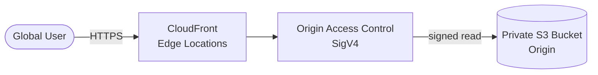

# AWS Global Static Site + CDN (Terraform)

> Secure, globally cached static website — private S3 origin behind CloudFront with Origin Access Control — provisioned with Terraform.
> **Author:** Muhammad Ahmad · **IaC:** Terraform · **Cloud:** AWS


---

## 📌 Overview

- **S3 bucket** stays **fully private** — no public access, no website hosting endpoint.
- **CloudFront** serves the content globally over **HTTPS**, caching at edge locations.
- **Origin Access Control (OAC + SigV4)** means only this CloudFront distribution can read the bucket.
- Sample `index.html` / `error.html` are uploaded by Terraform so the site works immediately.

## 🏗️ Architecture



## 🚀 Deploy

```bash
cd terraform
terraform init
terraform apply
```

CloudFront takes a few minutes to deploy. Then open the URL:

```bash
terraform output cloudfront_url
```

## 🧹 Clean up

```bash
terraform destroy
```

## 💰 Cost note

S3 storage for a few HTML files is negligible, and CloudFront has a generous free tier. Idle cost is near **$0**.

## 🔐 Production hardening (next steps)

- Add a **custom domain** with Route 53 + an **ACM certificate** (in `us-east-1`).
- Add a **CloudFront response headers policy** (HSTS, CSP).
- Add **CI/CD** to sync build output and invalidate the cache on deploy.

---

*Built and maintained by **Muhammad Ahmad**.*
