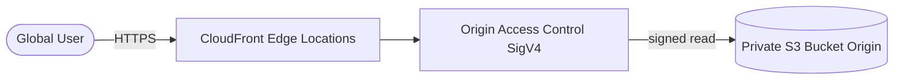

# Architecture Diagram — AWS Static Site + CDN

## Lucid diagram

- **Master Lucid document (all 30 diagrams, icon style):** https://lucid.app/lucidchart/3da75ce3-ea66-4296-81b3-00d20a60435b/edit
- This project is **page 3** of that document.

## Lucid prompt (reusable)

```
Create an AWS architecture diagram titled "AWS Global Static Site + CDN".
Left to right: a Global User connects over HTTPS to CloudFront (edge locations);
CloudFront uses Origin Access Control (SigV4) to make a signed read to a private
S3 bucket origin. Label arrows HTTPS and signed-read. Clean, professional AWS colors.
```

## Mermaid source


